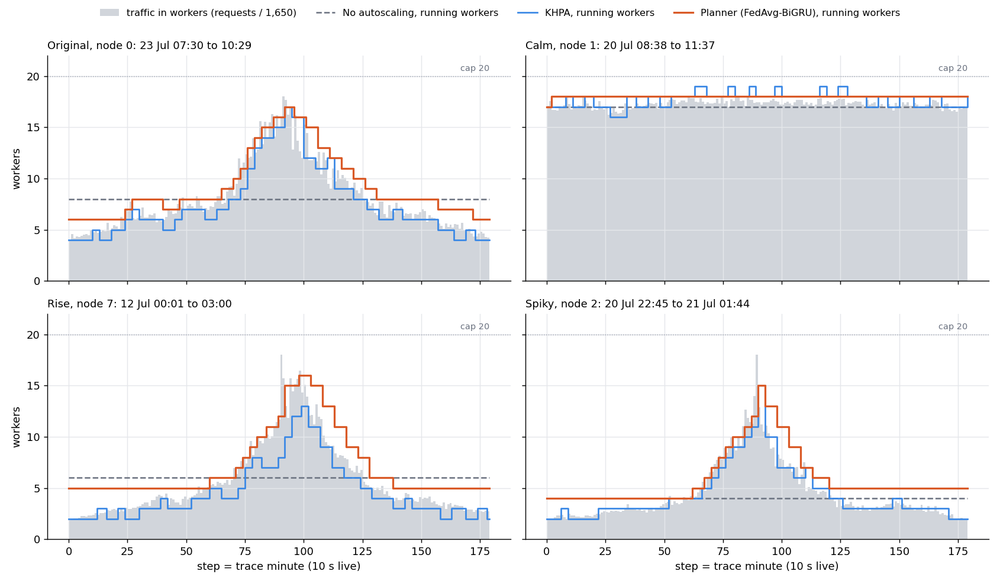
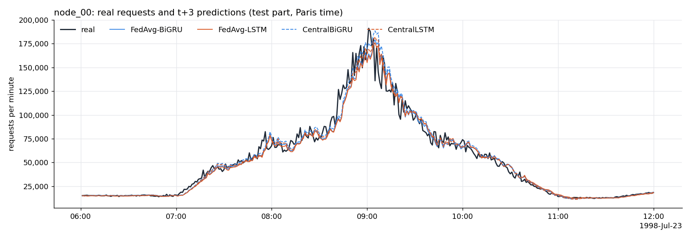

# Proactive fog autoscaling with federated learning

## Reproducing FedAvg-BiGRU Proactive Autoscaling (Dogani & Khunjush, 2024) on Docker

**Status:** 🚧 Phase 1 (reproduction) nearly complete, Phase 2 (extension) planned

This repository reproduces Dogani & Khunjush (2024), "Proactive auto-scaling technique for web applications in container-based edge computing using federated learning model" (JPDC 187, 104837). A FedAvg-BiGRU model forecasts each edge node's traffic, and a planner adds or removes containers before the load arrives. We test it in a simulation of 16 edge nodes and live, with real Docker containers on one laptop.

Bachelor thesis by Ahmed Hazem, German International University (GIU), Cairo.

Supervisors: Dr. Yasmine Zaghloul, Prof. Dr.-Ing. Ansgar Meroth.

---

## What This Project Does

Web traffic at the network edge rises and falls fast. A reactive autoscaler, such as the Kubernetes Horizontal Pod Autoscaler (KHPA), adds containers only after the CPU is already high, so users wait. Dogani & Khunjush forecast each edge node's traffic with a BiGRU trained by federated learning. A planner then adds containers before the load arrives. We rebuilt their whole pipeline. It starts from the FIFA World Cup 98 logs and makes 16 synthetic edge nodes. It trains four forecasting models, simulates three scalers, and runs them live with real Docker containers behind HAProxy.

Dogani's main claim holds. The planner has fewer shortages and scales less often than KHPA, in the simulation and in all four live windows. Live, it lost 2 requests, and KHPA lost 6,534. Our forecasts are less accurate than his, and some claims do not hold. On a flat window, no scaler beats fixed workers. Federated learning also sent more bytes than the raw data would have. The scorecard below lists every claim.

---

## Results at a Glance



*Live runs on four 3-hour windows: the traffic in workers (grey) and the workers each scaler ran.*



*Node 0 on 23 July 1998: real requests per minute and the t+3 forecasts of all four models.*

Our numbers next to Dogani's:

| Result | Dogani | Ours | Full report |
|---|---|---|---|
| FedAvg-BiGRU MAPE at t+3 / t+5 | 9.04% / 11.2% | 13.96% / 12.82% | [table8.md](results/predictors/table8.md) |
| Central BiGRU MAPE at t+3 / t+5 | 8.49% / 10.45% | 13.23% / 14.62% | [table8.md](results/predictors/table8.md) |
| Planner θU with FedAvg-BiGRU, simulated | 0.26 | 0.51 | [table11.md](results/autoscaler/table11.md) |
| εn planner / KHPA, simulated | 1.59 / 1.30 | 5.48 / 6.84 | [table11.md](results/autoscaler/table11.md) |
| Planner has fewer shortages than KHPA, live | yes | yes, in 4 of 4 windows | [windows_report.md](results/autoscaler_live/windows_report.md) |
| εn planner / KHPA, live, mean of 4 windows | 1.59 / 1.30 | 3.39 / 2.59 | [windows_report.md](results/autoscaler_live/windows_report.md) |
| Failed requests planner / KHPA, live, 4 windows | not reported | 2 / 6,534 | [windows_report.md](results/autoscaler_live/windows_report.md) |

- **Simulated εn:** KHPA wins in the main run, because it may drop to 1 pod while the planner keeps 5. With a minimum of 5 for both, the planner wins. With 1 for both, it is almost a tie. See findings 4.7 to 4.9 in the [decisions log](docs/decisions.md#findings-that-differ-from-dogani).
- **Why our numbers differ:** our traffic is much burstier, and the paper leaves several settings open. The decisions log explains every difference.

---

## Reproduction Scorecard

Each line is one of Dogani's claims, checked against our results.

- ✅ **Federated learning is about as good as central training.** FedAvg-BiGRU's MAE is within 3.5% of central BiGRU's at every step. The DM test still finds small, significant differences, because there are about 400,000 test windows ([finding 4.3](docs/decisions.md#43-federated-against-central)).
- ⚠️ **Forecast accuracy.** Our MAPE is higher than Dogani's: FedAvg-BiGRU 13.96% against 9.04% at t+3, and 12.82% against 11.2% at t+5 ([table8.md](results/predictors/table8.md)).
- ⚠️ **BiGRU beats LSTM.** Only at t+5 (DM p = 1.3e-10). At t+3 and t+4 the two do not differ significantly (p 0.158 and 0.137) ([finding 4.2](docs/decisions.md#42-bigru-beats-lstm-only-at-t5)).
- ✅ **The planner has fewer shortages than KHPA.** Lower θU and TU in all 4 live windows: mean θU 0.37 against 3.49 ([windows_report.md](results/autoscaler_live/windows_report.md)).
- ✅ **The planner has a higher εn than KHPA, live.** In all 4 windows: mean 3.39 against 2.59 ([windows_report.md](results/autoscaler_live/windows_report.md)).
- ⚠️ **The planner has a higher εn than KHPA, simulated.** It depends on the minimum pods. KHPA wins in the main run, 6.84 against 5.48 ([finding 4.8](docs/decisions.md#48-the-planner-beats-khpa-on-under-provisioning)).
- ✅ **The planner scales less often than KHPA.** In all 4 live windows: 14 scaling actions against 29 on average ([windows_report.md](results/autoscaler_live/windows_report.md)).
- ✅ **KHPA over-provisions less than the planner.** In all 4 live windows: mean θO 3.13 against 29.09 ([windows_report.md](results/autoscaler_live/windows_report.md)).
- ❌ **Both scalers beat no autoscaling.** Not on the calm window, where εn is 0.81 for KHPA and 1.00 for the planner ([finding 4.16](docs/decisions.md#416-on-a-flat-window-no-scaler-beats-fixed-workers)).
- ❌ **Federated learning reduces data transfer.** One FedAvg-BiGRU round sends 3.5 MB. After 9.1 rounds it passes the 32.1 MB of raw data, and our run used 19 rounds ([finding 4.4](docs/decisions.md#44-fl-sends-more-bytes-than-the-raw-data)).

---

## System Architecture

```
        FIFA World Cup 98 logs (1.35 billion requests, 87 days)
                              |
                              v
                     requests per minute
                              |
                              v
        16 synthetic edge nodes (same distribution and ACF)
                              |
                              v
      BiGRU / LSTM trained with FedAvg (16 clients), and centrally
                              |
                              v
                     forecasts t+3 .. t+5
                              |
                              v
        Planner (Algorithm 3)  vs  KHPA  vs  no autoscaling
                              |
                              v
        HAProxy + up to 20 Docker workers (0.5 CPU each)
                              |
                              v
                     Prometheus / cAdvisor
                              |
                              v
        Grafana + metrics (θU, θO, TU, TO, εn)
```

Step 4A runs the scalers in a Python simulation of all 16 nodes. Step 4B runs them live, with the real containers shown above.

---

## Key Design Decisions

Every choice we made, and every place where our results differ from the paper, is in [docs/decisions.md](docs/decisions.md). Each entry says what Dogani says, what we did and why. These are the main ones:

| Decision | Choice | Reason |
|---|---|---|
| [2.2](docs/decisions.md#22-empirical-draw-instead-of-a-fitted-distribution) Synthetic traces | Draw real values with replacement, not from a fitted distribution | No fitted distribution passed the Anderson-Darling test on 125,280 minutes |
| [3.2](docs/decisions.md#32-window-length-w--30) Input window | 30 minutes | The paper leaves it open, and 30 won against 60 on the validation set |
| [3.7](docs/decisions.md#37-fedavg-settings) FedAvg | All 16 clients every round, 1 local epoch | The simplest settings that follow Algorithm 2, which gives none |
| [4A.4](docs/decisions.md#4a4-line-6-of-algorithm-3) Algorithm 3, line 6 | Use the maximum of the next 3 forecasts | Line 6 as printed is a typo, otherwise line 5 would be useless |
| [4A.10](docs/decisions.md#4a10-main-run-and-fair-runs) Simulation settings | Mean demand 15 pods, threshold 0.7, plus two fair runs | Closest to Dogani's Table 11; the fair runs give both scalers the same minimum |
| [4B.1](docs/decisions.md#4b1-docker-on-one-laptop-not-kubernetes) Live cluster | Docker on one laptop, not Kubernetes | Tests real CPU, start-up and response times without a cluster to set up |
| [4B.5](docs/decisions.md#4b5-time-compression) Time compression | One trace minute takes 10 s | A 3-hour window then runs in about 31 minutes |
| [4B.14](docs/decisions.md#4b14-khpas-cpu-read-wait-for-a-fresh-scrape) KHPA's CPU read | Wait for a fresh Prometheus scrape | Without it, KHPA saw only 82% of the real CPU on the rise window |

The entries are numbered by step. The part before the dot names the step, and the part after it counts that step's entries. Reports and commits cite these numbers, for example "decision 4B.14".

- **1.1 to 1.4:** the FIFA trace.
- **2.1 to 2.6:** the synthetic node traces.
- **3.1 to 3.10:** the predictors.
- **4A.1 to 4A.10:** the simulation, the settings of Table 3 and how we read Algorithm 3.
- **4B.1 to 4B.14:** the live demo: the worker, the calibration, the windows and the fixed KHPA CPU read.
- **Findings 4.1 to 4.18:** a section of their own at the end. These are results that differ from Dogani, or that the paper does not report.

---

## Project Status

| Component | Status |
|---|---|
| 1. FIFA workload: requests per minute of the World Cup 98 logs, 1,352,804,107 requests over 87 days | Done, see [decisions, step 1](docs/decisions.md#step-1-the-real-fifa-workload) |
| 2. Synthetic traces: 16 edge-node traces with the distribution and autocorrelation of the real trace | Done, see [decisions, step 2](docs/decisions.md#step-2-synthetic-traces-for-16-edge-nodes) |
| 3. Predictors: FedAvg-BiGRU, FedAvg-LSTM and their central versions, compared like Dogani's Table 8 | Done, see [table8.md](results/predictors/table8.md) |
| 4A. Simulation: no autoscaling, KHPA and the planner on all 16 nodes, like Dogani's Table 11 | Done, see [table11.md](results/autoscaler/table11.md) |
| 4B. Live demo: real traffic against real Docker containers behind HAProxy, on node 0's busiest 3 hours | Done, see [report.md](results/autoscaler_live/report.md) |
| 4B. Extra windows: the calm, rise and spiky windows, chosen by a fixed rule | Done, see [windows_report.md](results/autoscaler_live/windows_report.md) |
| Thesis writing | In progress |
| Phase 2: extension | Planned |

Before the reproduction, the thesis built a testbed for vertical CPU scaling of two containers. Its code and results are in this repo too, see [the earlier part](#earlier-part-vertical-cpu-scaling).

---

## Repository Structure

```
.
├── README.md                  # this overview
├── .gitignore                 # keeps data/, .venv/, Python caches and the earlier part's live load files out of git
├── docker-compose.yml         # cAdvisor, Prometheus and Grafana, plus the two workers of the earlier part
├── docs/                      # the decisions log, the live demo guide and the guides of the earlier part
│   ├── decisions.md           # every choice and every difference from the paper
│   └── demo_live.md           # the live demo of step 4B, step by step
├── scripts/                   # one command-line script per step: build the data, train, simulate, run live, report
│   └── requirements.txt       # the Python packages of steps 1 to 4A
├── predictors/                # step 3: features, models, FedAvg and evaluation
├── autoscaler/                # steps 4A and 4B: KHPA, the planner, the metrics, the live cluster, the load generator
├── live/                      # the worker container of the live demo
├── monitoring/                # the Prometheus config and the Grafana dashboards
├── results/                   # all reports, tables, plots and CSVs of every step
│   ├── predictors/            # step 3, Table 8
│   ├── autoscaler/            # step 4A, Table 11 (main run)
│   ├── autoscaler_fair/       # step 4A, the fair runs
│   ├── autoscaler_sensitivity/  # step 4A, the sensitivity grid
│   └── autoscaler_live/       # step 4B, the first window, plus calm/, rise/ and spiky/
├── tests/                     # unit tests for every step
├── controller/                # earlier part: the reactive and proactive CPU controllers
├── workload/                  # earlier part: the training workload of the two worker containers
├── load/                      # earlier part: named load profiles for those workers
├── analysis/                  # earlier part: scripts that compare the controller runs
├── figures/                   # earlier part: PDF figures of the first controller runs
└── data/                      # git-ignored, about 9 GB: the raw FIFA logs, the per-minute trace, the 16 node
                               # traces, the model weights and the raw data of every run; Quick Start rebuilds it
```

Each folder has a README with its file list: [docs/](docs/), [scripts/](scripts/), [predictors/](predictors/), [autoscaler/](autoscaler/), [live/](live/), [monitoring/](monitoring/), [results/](results/), [tests/](tests/), [controller/](controller/), [workload/](workload/), [load/](load/), [analysis/](analysis/) and [figures/](figures/). The top-level files are [README.md](README.md), [.gitignore](.gitignore) and [docker-compose.yml](docker-compose.yml).

---

## Quick Start

**Prerequisites:** Linux with Docker and Python 3.10, and about 9 GB of free disk for `data/`. Step 3 took 34 min on an RTX 4060 laptop GPU. The live demo needs ports 3000, 8080, 8090, 8091, 8404 and 9090 free.

Run every command from the repo root.

**1. Set up Python** (once):

```bash
python3 -m venv .venv
.venv/bin/pip install -r scripts/requirements.txt
```

**2. Build the data and train** (steps 1 to 3):

```bash
.venv/bin/python scripts/fifa_workload.py                                            # about 45 min, mostly downloading 8.2 GB
.venv/bin/python scripts/synthetic_traces.py --cdf empirical                         # 6.2 h
.venv/bin/python scripts/synthetic_traces.py --cdf empirical --resume data/synthetic # then 1.2 h
.venv/bin/python scripts/train_predictors.py                                         # 34 min on an RTX 4060 laptop GPU
```

**3. Simulate the scalers** (step 4A):

```bash
.venv/bin/python scripts/simulate_autoscaler.py          # 15 s
.venv/bin/python scripts/simulate_autoscaler.py --pods-min 1 --khpa-pods-min 1 --out-dir results/autoscaler_fair/pods_min_1 --pods-dir data/autoscaler_fair/pods_min_1   # 15 s
.venv/bin/python scripts/simulate_autoscaler.py --pods-min 5 --khpa-pods-min 5 --out-dir results/autoscaler_fair/pods_min_5 --pods-dir data/autoscaler_fair/pods_min_5   # 15 s
.venv/bin/python scripts/autoscaler_sensitivity.py       # 20 s
```

**4. Start the live setup** (step 4B):

```bash
docker compose up -d cadvisor prometheus grafana
docker build -t thesis/live-worker:latest live/worker
docker pull haproxy:2.8.10-alpine
.venv/bin/python scripts/live_calibrate.py                  # about 5 min
.venv/bin/python scripts/live_prepare.py                    # the first window, node 0
```

**5. Watch a live demo** (5 min). Open Grafana at http://localhost:3000/d/autoscaler-live, then:

```bash
.venv/bin/python scripts/live_run.py --scaler planner --first-step 60 --steps 27 --tag demo
.venv/bin/python scripts/live_report.py --tag demo
```

The full guide is [docs/demo_live.md](docs/demo_live.md).

**6. Run the first window in full** (about 31 min per run):

```bash
.venv/bin/python scripts/live_run.py --scaler none          # then --scaler khpa and --scaler planner
.venv/bin/python scripts/live_report.py
```

**7. Run the other three windows**, here the calm one:

```bash
.venv/bin/python scripts/live_windows.py                    # picks the windows by the rule of decision 4B.12
.venv/bin/python scripts/live_prepare.py --node 1 --start "1998-07-20 08:38" --out-dir results/autoscaler_live/calm
.venv/bin/python scripts/live_run.py --scaler none --window-dir results/autoscaler_live/calm --out-dir results/autoscaler_live/calm --data-dir data/autoscaler_live/calm
.venv/bin/python scripts/live_report.py --dir results/autoscaler_live/calm
```

| Window | Node | First minute |
|---|---|---|
| calm | 1 | 1998-07-20 08:38 |
| rise | 7 | 1998-07-12 00:01 |
| spiky | 2 | 1998-07-20 22:45 |

Rise and spiky use the same commands with their own node, first minute and folder. After the reports of all four windows, `.venv/bin/python scripts/live_windows_report.py` writes [windows_report.md](results/autoscaler_live/windows_report.md).

Each window needs 3 runs of about 31 minutes, so all 12 runs take about 6.2 h. The live runs start and remove their own containers, labelled `thesis.live=1`, and use at most 20 of them.

**8. Run the tests** (about 10 s):

```bash
.venv/bin/python -m unittest discover -s tests
```

---

## Useful Commands

| Command | Description |
|---|---|
| `.venv/bin/python -m unittest discover -s tests` | Runs all unit tests, about 10 s |
| `docker compose up -d cadvisor prometheus grafana` | Starts the monitoring stack |
| `.venv/bin/python scripts/live_run.py --scaler planner --first-step 60 --steps 27 --tag demo` | A 5-minute live demo of the planner; `khpa` or `none` for the others |
| `.venv/bin/python scripts/live_report.py --tag demo` | The table and plot of the demo runs |
| `.venv/bin/python scripts/live_report.py --dir results/autoscaler_live/calm` | The report of one window folder |
| `.venv/bin/python scripts/live_windows_report.py` | The report over all four windows |
| `.venv/bin/python scripts/simulate_autoscaler.py` | The step 4A simulation, 15 s |
| `docker rm -f $(docker ps -aq --filter label=thesis.live=1)` | Removes leftover live containers by hand; touches only containers with that label |

Grafana runs at http://localhost:3000 and Prometheus at http://localhost:9090.

---

## Technical Stack

| Layer | Technology | Detail |
|---|---|---|
| Language | Python 3.10 | All scripts, run from `.venv` |
| Forecasting | PyTorch | BiGRU and LSTM with 64 units; FedAvg with 16 clients in one process |
| Data and plots | NumPy, SciPy, matplotlib, holidays | Traces, ACF matching, reports and French holidays as a feature |
| Training hardware | RTX 4060 laptop GPU | Step 3 in 34 min |
| Containers | Docker | Workers from python:3.11-slim with numpy, 0.5 CPU and 256 MB each, at most 20 |
| Load balancer | HAProxy 2.8.10 | Round robin; workers switched on and off through its runtime API |
| Load generator | Python asyncio | Open loop with 6,000 keep-alive connections |
| Metrics | cAdvisor v0.49.1, Prometheus v2.53.0 | Container CPU, scraped every 5 s |
| Dashboards | Grafana 11.1.0 | The live dashboard `autoscaler-live` |

---

## Earlier Part: Vertical CPU Scaling

Two containers share one CPU while they train a small model. A reactive and a proactive controller change their CPU limits every 5 s. The proactive controller beat the reactive one under every load profile.

- **Results:** [results/profiles_summary.md](results/profiles_summary.md).
- **Demo guide:** [docs/demo.md](docs/demo.md).
- **Concepts:** [docs/concepts.md](docs/concepts.md).

---

**Author:** Ahmed Hazem  
**Supervisors:** Dr. Yasmine Zaghloul (first), Prof. Dr.-Ing. Ansgar Meroth (second)  
German International University (GIU), Bachelor Thesis
