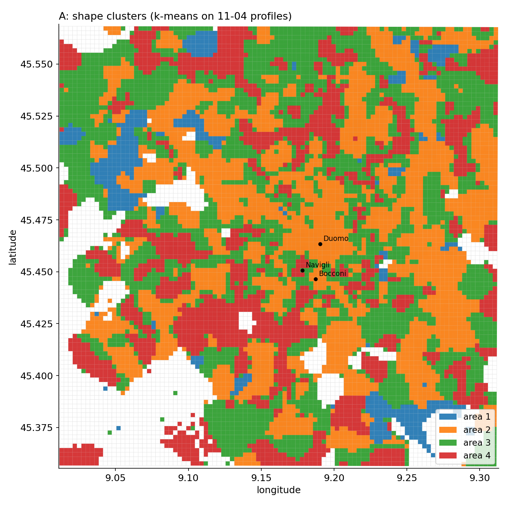
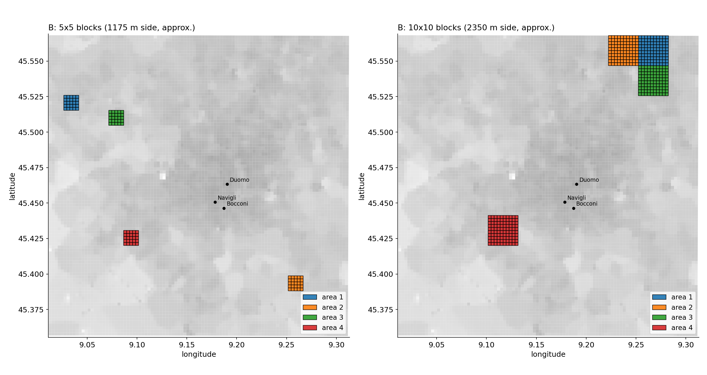
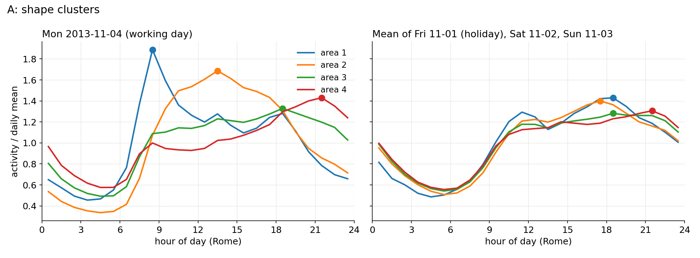
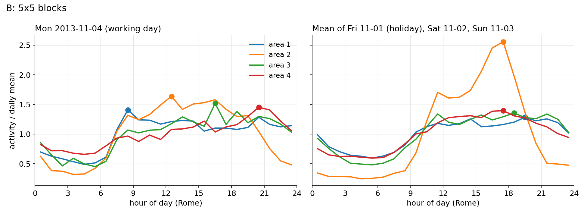
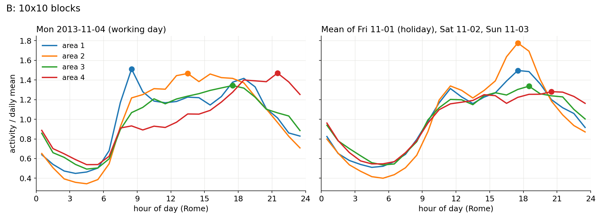
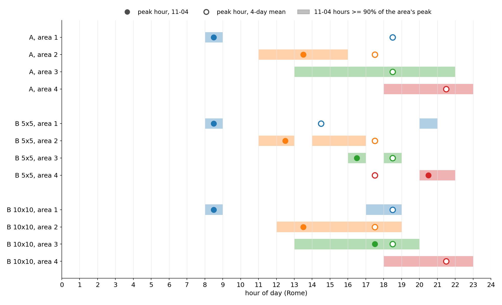

# Milan: 4 areas with different internet peak times (exploration)

Goal: 4 areas of Milan whose internet activity peaks at clearly different times of day, from the 4 days on disk. Exploration only; nothing is decided yet.

Script: `scripts/milan_areas.py` (numpy, scipy, matplotlib). Outputs: `results/milan/areas/` (`tables.md`, `areas.json`, 7 figures). Run with
`.venv/bin/python scripts/milan_areas.py --data-dir <folder with the 4 days and milano-grid.geojson>`.

## What was done

1. **Data.** The 4 processed days 2013-11-01 to 11-04 in `data/raw/milan/` (made on 2026-10-24 by `scripts/download_milan.py`, which is not yet in the repo: one row per square and 10 minutes, summed over all country codes). Only `internet` is used. Each `time_ms` is converted to Europe/Rome time; the script checks that every file runs 00:00 to 23:50 Rome time on its own date in 144 steps of 10 minutes. Values are summed to 24 hourly values per square and day; "08:00" means 08:00-08:59.
2. **Empty cells.** Handled both ways (see below); the main results use empty = 0.
3. **Day types.** 11-04 is reported apart from the other 3 days (see below). The areas are chosen from 11-04 alone.
4. **Low-activity cut-off.** Drop the quietest squares that together hold 1% of all internet activity of the 4 days.
5. **A, shape clustering.** Each kept square's 11-04 hourly profile is z-scored (minus its mean, divided by its standard deviation), then k-means with k = 4 (k-means++ starts, 20 restarts, seed 0, the restart with the lowest within-group distance wins). Why: after z-scoring, the squared distance between two profiles is 2 x 24 x (1 - their correlation), so k-means groups squares by *when* activity rises and falls, not by how large or how peaky it is. k-means is the simplest method with a fixed number of groups. The areas are numbered by the peak hour of their group centre.
6. **B, compact blocks.** The 100 x 100 grid is tiled from its south-west corner into 5x5 blocks (400 blocks, about 1.2 km side) and 10x10 blocks (100 blocks, about 2.4 km side; a square is "about 235×235 meters", Barlacchi et al. 2015, Methods). A block's profile is the sum of all its squares (the cut-off is not applied: summing, unlike z-scoring, does not blow up the noise of quiet squares). Candidates: blocks with at least the median block demand (so no near-empty fields at the edge of the grid). Choice: the 4 blocks whose 11-04 peak hours are furthest apart (largest smallest gap on a 24-hour clock), among sets whose largest 4-day demand is at most 2 x the smallest; ties go to the smallest demand ratio.
7. **Per area (step 6).** Peak hour on 11-04, on the mean of the other 3 days and on the 4-day mean; peak/mean; how many 11-04 hours lie within 90% of the area's own peak (1 = a sharp peak); share of the city's 4-day demand and of the 4 areas' demand; hours in which 2 or more areas are within 90% of their own peak; number of connected regions (squares sharing a side) and the share of the largest. Landmarks: the Milan squares named in the paper, "Duomo, the city centre of Milan (Square id: 5060)", "Bocconi, one of the most famous Universities in Milan (Square id: 4259)" and "Navigli district, one of the most famous nightlife places in Milan (Square id: 4456)" (Barlacchi et al. 2015, Usage Notes).

## Empty cells: zero or missing?

The paper does not say. Its definition of the column is "Internet traffic activity: number of CDRs generated inside a given Square id during a given Time interval" (Barlacchi et al. 2015, Data Records). A search of the paper's text for empty, missing, null, zero, blank, absent and "not available" finds only the precipitation data ("Absent: precipitation quantity equal to 0 mm/h"), nothing on the telecom files. So: **UNCONFIRMED**. None of the 4 days holds an explicit 0 in `internet` (smallest value 0.00097 on 11-01 and 0.0029 on the other days, counted with awk on 2026-11-01), which fits "empty = no activity", but that is an inference.

Both ways were run: empty = 0, and empty = missing (an hour is the mean of its known 10-minute values x 6). Missing rows (no line at all for a square and time) are treated like empty cells. Only 8 of 10,000 squares have a gap on any day, and **both ways give exactly the same areas for A, 5x5 and 10x10** (numbers in the first table below).

## 11-04 is the only normal working day

- 2013-11-01 (Friday) was a public holiday, All Saints' Day. Legge 27 maggio 1949, n. 260, Art. 2, lists among the festive days "il giorno di Ognissanti" (Normattiva, current consolidated text, read 2026-11-01). Legge 5 marzo 1977, n. 54, Art. 1, removed "Epifania; S. Giuseppe; Ascensione; Corpus Domini; SS. Apostoli Pietro e Paolo" and moved the national unity celebration, which now takes place "nella prima domenica di novembre"; it does not remove Ognissanti (Normattiva, read 2026-11-01). The Python package `holidays` 0.106 also gives 2013-11-01 "All Saints' Day" for Italy and nothing for 11-04.
- 2013-11-02 was a Saturday and 11-03 a Sunday (computed with Python's datetime). 11-03, the first Sunday of November, was also the national unity day under Law 54/1977.
- 2013-11-04 was a Monday with no holiday, the only normal working day of the 4.

So "4-day mean" mixes 1 working day with 1 holiday and a weekend; the tables show 11-04 and the other 3 days apart.

## Results

Tables from `results/milan/areas/tables.md` (written by the script).

### Data

| Day | Empty internet cells | Missing rows | Squares with a gap |
|---|---|---|---|
| 2013-11-01 | 36 | 18 | 7 |
| 2013-11-02 | 84 | 14 | 4 |
| 2013-11-03 | 108 | 37 | 3 |
| 2013-11-04 | 103 | 24 | 1 |

Squares with a gap on any day: 8 (5239, 7623, 7722, 7727, 7823, 7824, 7825, 7925). Of these, 1 fall under the low-activity cut-off.
Empty = missing leaves 2013-11-01: 0, 2013-11-02: 1, 2013-11-03: 1, 2013-11-04: 1 squares with an hour that has no known slot at all.
Same areas with empty = 0 and empty = missing: A True, 5x5 True, 10x10 True.

### Low-activity cut-off

Dropped: the 1393 quietest squares, which together hold 1% of all internet activity of the 4 days (each has a 4-day total of at most 4284.0). Kept: 8607. Median 4-day total of all squares: 17979.3.

### A: shape clusters

| Area | Squares | Peak 11-04 | Peak other 3 days | Peak 4-day mean | Peak/mean 11-04 | Peak/mean 4-day | Hours >= 90% of peak, 11-04 | Share of city | Share of the 4 | Connected regions (largest) | Landmarks |
|---|---|---|---|---|---|---|---|---|---|---|---|
| 1 | 493 | 08:00 | 18:00 | 18:00 | 1.89 | 1.39 | 1 | 2.4% | 2.5% | 38 (30%) | - |
| 2 | 2980 | 13:00 | 17:00 | 17:00 | 1.69 | 1.41 | 5 | 37.0% | 37.4% | 91 (30%) | Duomo, Bocconi |
| 3 | 3122 | 18:00 | 18:00 | 18:00 | 1.33 | 1.30 | 9 | 37.8% | 38.2% | 252 (13%) | Navigli |
| 4 | 2012 | 21:00 | 21:00 | 21:00 | 1.43 | 1.34 | 5 | 21.7% | 22.0% | 98 (18%) | - |

Hours in which 2 or more areas are within 90% of their own peak: 11-04: 7 (13, 14, 15, 18, 19, 20, 21); 4-day mean: 12 (11, 12, 13, 14, 15, 16, 17, 18, 19, 20, 21, 22).

### B: 5x5 blocks

Blocks (block row, block col from the south-west): (15, 1), (3, 16), (14, 4), (6, 5). Smallest gap between the 11-04 peak hours: 4 h. Largest / smallest 4-day demand: 1.03.

| Area | Squares | Peak 11-04 | Peak other 3 days | Peak 4-day mean | Peak/mean 11-04 | Peak/mean 4-day | Hours >= 90% of peak, 11-04 | Share of city | Share of the 4 | Connected regions (largest) | Landmarks |
|---|---|---|---|---|---|---|---|---|---|---|---|
| 1 | 25 | 08:00 | 19:00 | 14:00 | 1.41 | 1.25 | 2 | 0.2% | 25.4% | 1 (100%) | - |
| 2 | 25 | 12:00 | 17:00 | 17:00 | 1.64 | 2.29 | 5 | 0.2% | 24.7% | 1 (100%) | - |
| 3 | 25 | 16:00 | 18:00 | 18:00 | 1.52 | 1.36 | 2 | 0.2% | 25.1% | 1 (100%) | - |
| 4 | 25 | 20:00 | 17:00 | 17:00 | 1.45 | 1.33 | 2 | 0.2% | 24.8% | 1 (100%) | - |

Hours in which 2 or more areas are within 90% of their own peak: 11-04: 2 (16, 20); 4-day mean: 12 (11, 12, 13, 14, 15, 16, 17, 18, 19, 20, 21, 22).

### B: 10x10 blocks

Blocks (block row, block col from the south-west): (9, 8), (9, 7), (8, 8), (3, 3). Smallest gap between the 11-04 peak hours: 4 h. Largest / smallest 4-day demand: 1.23.

| Area | Squares | Peak 11-04 | Peak other 3 days | Peak 4-day mean | Peak/mean 11-04 | Peak/mean 4-day | Hours >= 90% of peak, 11-04 | Share of city | Share of the 4 | Connected regions (largest) | Landmarks |
|---|---|---|---|---|---|---|---|---|---|---|---|
| 1 | 100 | 08:00 | 17:00 | 18:00 | 1.51 | 1.47 | 3 | 1.0% | 22.9% | 1 (100%) | - |
| 2 | 100 | 13:00 | 17:00 | 17:00 | 1.47 | 1.68 | 7 | 1.1% | 24.6% | 1 (100%) | - |
| 3 | 100 | 17:00 | 18:00 | 18:00 | 1.34 | 1.33 | 7 | 1.1% | 24.2% | 1 (100%) | - |
| 4 | 100 | 21:00 | 20:00 | 21:00 | 1.47 | 1.33 | 5 | 1.3% | 28.2% | 1 (100%) | - |

Hours in which 2 or more areas are within 90% of their own peak: 11-04: 7 (13, 14, 15, 16, 17, 18, 19); 4-day mean: 7 (14, 15, 16, 17, 18, 19, 20).

### Figures

Maps (grey = 4-day activity of every square, darker = more; white in A = dropped by the cut-off):

Daily profiles, each area divided by its own daily mean (dot = peak):

24-hour timeline: filled dot = 11-04 peak, hollow = 4-day mean peak, bar = 11-04 hours within 90% of the area's peak:

## What the numbers show

- **Different peak times exist only on the working day.** On 11-04 all three sets peak at 4 different times: A at 08, 13, 18 and 21; 5x5 at 08, 12, 16 and 20; 10x10 at 08, 13, 17 and 21. On the mean of the holiday and the weekend, 10 of the 12 areas peak between 17:00 and 19:00 (A4 at 21:00, 10x10 area 4 at 20:00). The whole city peaks at 13:00 on 11-04 and at 18:00 on the other 3 days.
- **A is clean in time but scattered in space.** Its 4 shapes are smooth (hundreds to thousands of squares each), and area 1 has the sharpest peak of all (1 hour at 90%, peak/mean 1.89). But every area is split into 38 to 252 separate regions, the largest holding only 13 to 30% of its squares, and the demand is very unequal (2.5% to 38.2% of the 4).
- **B is connected and balanced, but the peaks are weak.** Each block is one region, and demand is comparable (largest / smallest 1.03 for 5x5, 1.23 for 10x10). But the chosen peaks are only a few percent above the next-best hour (computed from the 11-04 profiles: 5x5 3.3 to 9.8%, 10x10 0.3 to 6.7%), and some areas have two separate peaks within 90%: 5x5 area 1 at 08 and 20, 5x5 area 3 at 16 and 18, 10x10 area 1 at 08 and 17-18. 10x10 area 2's 13:00 is only 0.3% above its 15:00.
- **5x5 vs 10x10.** 5x5 has the least overlap (2 hours on 11-04, against 7 for both A and 10x10), but its blocks are quiet (0.2% of the city each) and noisier. 10x10's 4 shapes look like A's 4 (morning, midday, afternoon, evening), but 3 of its 4 blocks touch each other at the northern edge of the grid, east of the centre.

## Recommendation: B, but not these exact blocks yet

An ESP "covering an area" needs one connected region, which rules out A as it stands: each A area is 38 to 252 pieces spread over the whole grid. B gives connected areas with comparable demand, so B is the method to keep. Of the two runs, 10x10 is the safer start: its profiles are smoother and match A's four shapes. But its peaks are not clearly separated (7 shared peak hours, two areas with near-tied peaks), and 5x5's separation rests on 25 squares and one day.

A next step to discuss (not done): choose compact blocks *inside* A's clusters, e.g. per A area the block whose squares mostly belong to that area, with comparable demand. That would combine A's clean shapes with B's connectedness. Both methods also need more working days than 1 before the peak hours can be trusted (more days need a download; not done).

## UNCONFIRMED

- What an empty cell means (zero or missing). Both ways give the same areas here.
- The time zone of `time_ms`: the paper does not state it. Europe/Rome is inferred, because every file runs exactly 00:00-23:50 Rome time on its own date (checked by the script).
- Whether 11-04 is a typical working day: it is the only one available.
- Why an area peaks when it does (offices, homes, commuting, events): the data has no land use. The 08:00 peaks and 5x5 area 2's holiday peak (2.29 x its mean, 4-day) are not explained.
- The 2013 wording of Law 260/1949, Art. 2: only today's consolidated text was read. Law 54/1977 and the `holidays` package agree that All Saints' Day was a holiday in 2013.
- My choices, none from the paper: the 1% cut-off, z-scoring, k-means with k = 4 on 11-04 only, tiling from the south-west corner (another offset gives other blocks), the median-demand candidate rule, the demand ratio of 2 and the 90% peak band.
- Values are rounded to 6 significant digits by `download_milan.py` (its own comment). That script and `docs/milan_dataset.md` are not yet in the repo.
