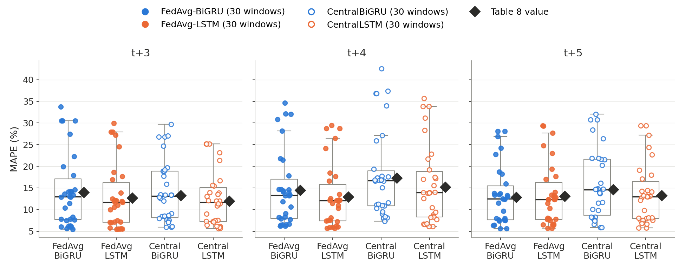
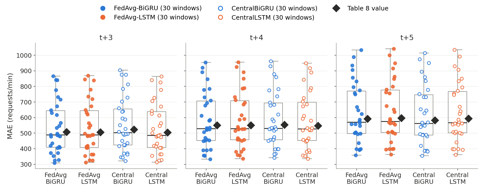
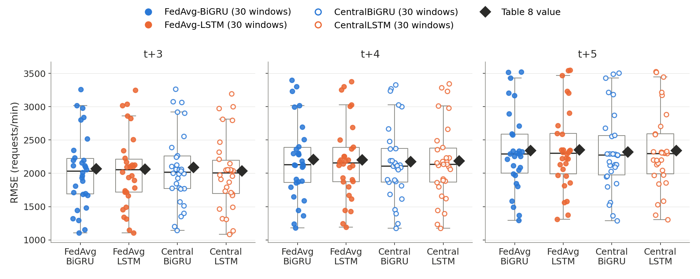
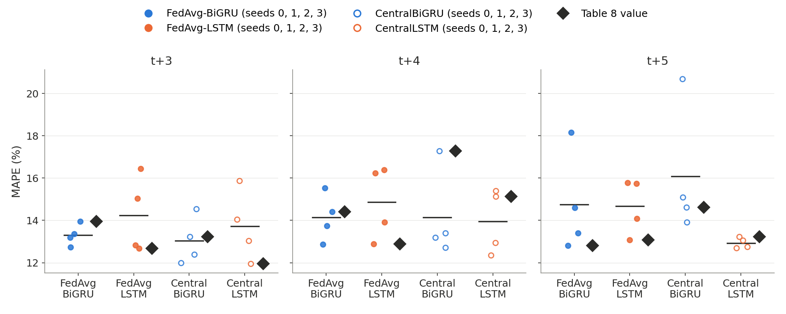
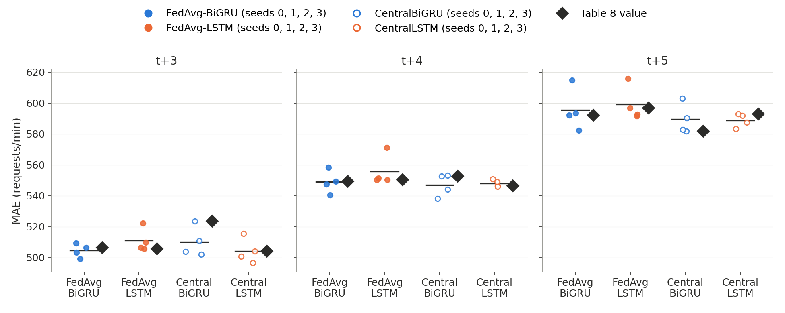
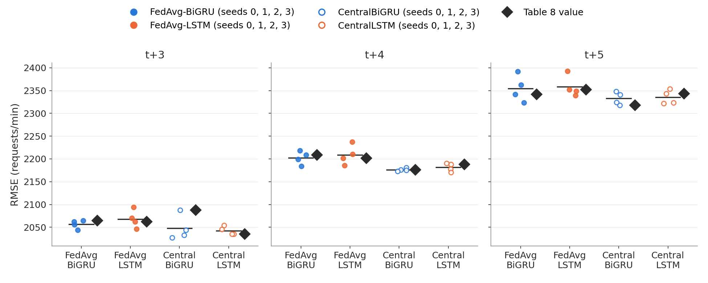
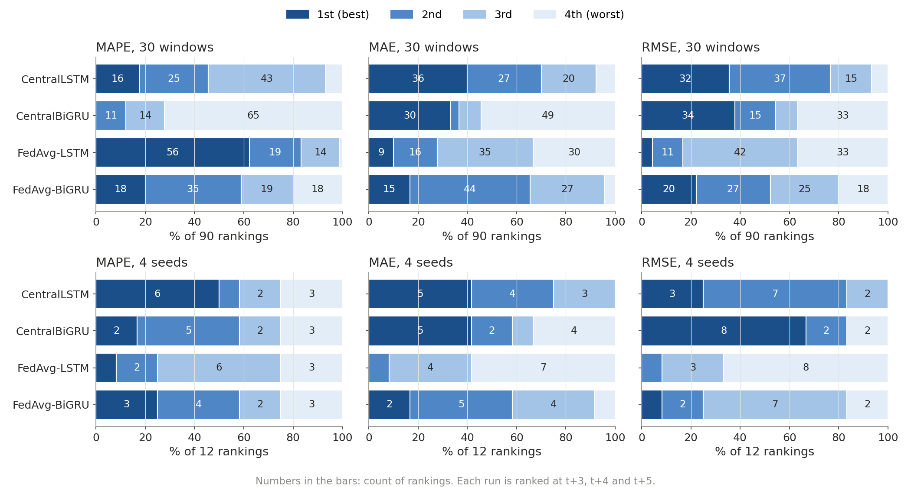
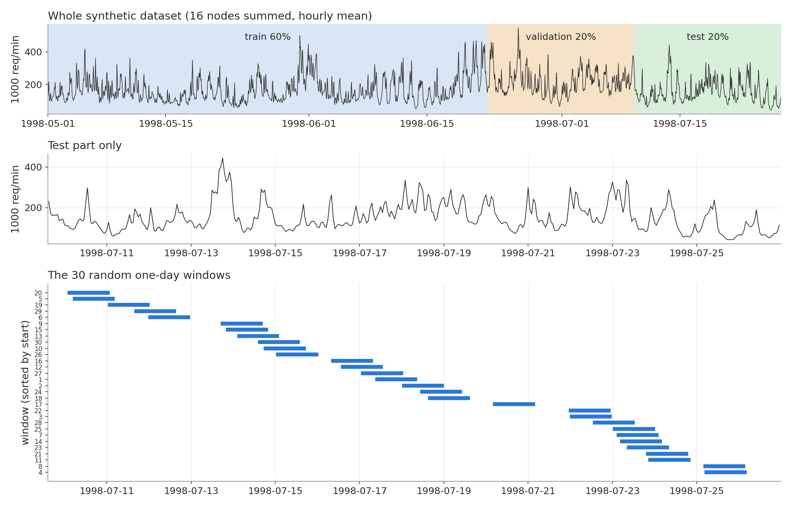

# Task 1: was our Table 8 luck?

**Request (Dr. Yasmine Zaghloul):** run random time windows on the synthetic dataset of the Dogani reproduction and check that the results differ only slightly, to show that our Table 8 was not luck.

## What we did

- **Data:** the 16 synthetic FIFA 1998 node traces of step 2 (one value per minute, 1998-05-01 00:00 to 1998-07-26 23:59, 125,280 minutes per node). Each node is split in time order: 60% train, 20% validation, 20% test. The test forecasts run from 1998-07-09 14:54 to 1998-07-26 23:55, which is 25,022 forecasts per node, about 17.4 days (`results/predictors/report.json`).
- **Models:** the 4 models of Table 8 (FedAvg-BiGRU, FedAvg-LSTM, CentralBiGRU, CentralLSTM), with input window W = 30 and patience 10. Metrics: MAPE, MAE and RMSE at t+3, t+4 and t+5, pooled over all 16 nodes.
- **Random seeds (PR #33, merged 2026-10-24):** all 4 models trained again with seeds 1, 2 and 3. Seed 0 is the Table 8 run, so there are 4 seeds. Each seed is scored on the whole test part. Training took 34.1, 44.3, 40.7 and 28.7 min (seeds 0 to 3, RTX 4060).
- **Random windows (PR #34, merged 2026-10-24):** the trained seed-0 models (no retraining) scored on 30 random one-day windows (1,440 forecasts each), the same minutes on all 16 nodes. The starts are drawn uniformly from all possible starts in the test part, with seed 1 (`numpy.random.default_rng(1).integers`). Every window lies in the test part, so no window overlaps the training data. The windows do overlap each other: together they cover 19,367 of the 25,022 test minutes (77.4%), and up to 6 windows share one minute.
- **This summary:** `scripts/task1_wrapup.py` only reads the results of the two PRs (no training, no scoring) and writes `results/task1/`. As a check, seed 0 in the seed results matches Table 8 to 4 decimals. PR #34 already checked that the seed-0 weights reproduce Table 8 exactly on the whole test part.

Table 8 itself is `results/predictors/table8.md` (full-precision values in `results/predictors/metrics.csv`). It is our version of Dogani's Table 8: the forecast error of the 4 predictors on the test part (last 20%) of all 16 synthetic nodes, in requests per minute (MAPE in %).

## Results

Windows: n = 30 one-day windows, seed-0 models. Seeds: n = 4 (seeds 0 to 3, whole test part; seed 0 is Table 8). sd is the sample standard deviation.

Tables from `results/task1/tables.md` (written by `scripts/task1_wrapup.py`).

### MAPE (%)

| Model | Step | Table 8 | Windows mean ± sd (n=30) | Windows min to max | Seeds mean ± sd (n=4) | Seeds min to max |
|---|---|---|---|---|---|---|
| FedAvg-BiGRU | t+3 | 13.96 | 14.40 ± 8.54 | 5.45 to 33.74 | 13.31 ± 0.51 | 12.73 to 13.96 |
| FedAvg-BiGRU | t+4 | 14.41 | 14.91 ± 8.72 | 6.17 to 34.66 | 14.14 ± 1.13 | 12.87 to 15.54 |
| FedAvg-BiGRU | t+5 | 12.82 | 13.33 ± 6.81 | 5.63 to 28.10 | 14.75 ± 2.39 | 12.82 to 18.16 |
| FedAvg-LSTM | t+3 | 12.68 | 12.98 ± 7.58 | 5.49 to 29.97 | 14.24 ± 1.82 | 12.68 to 16.44 |
| FedAvg-LSTM | t+4 | 12.89 | 13.17 ± 7.45 | 5.68 to 29.47 | 14.86 ± 1.73 | 12.89 to 16.39 |
| FedAvg-LSTM | t+5 | 13.08 | 13.41 ± 7.16 | 5.69 to 29.37 | 14.68 ± 1.32 | 13.08 to 15.78 |
| CentralBiGRU | t+3 | 13.23 | 14.21 ± 7.22 | 5.90 to 29.75 | 13.04 ± 1.13 | 11.99 to 14.55 |
| CentralBiGRU | t+4 | 17.28 | 18.16 ± 10.11 | 7.29 to 42.54 | 14.15 ± 2.11 | 12.72 to 17.28 |
| CentralBiGRU | t+5 | 14.62 | 15.79 ± 8.00 | 5.88 to 32.03 | 16.08 ± 3.11 | 13.92 to 20.68 |
| CentralLSTM | t+3 | 11.95 | 12.45 ± 6.22 | 5.65 to 25.20 | 13.73 ± 1.67 | 11.95 to 15.88 |
| CentralLSTM | t+4 | 15.13 | 15.65 ± 9.02 | 6.10 to 35.70 | 13.95 ± 1.53 | 12.35 to 15.39 |
| CentralLSTM | t+5 | 13.24 | 13.69 ± 6.98 | 5.75 to 29.37 | 12.93 ± 0.26 | 12.69 to 13.24 |

### MAE (requests/min)

| Model | Step | Table 8 | Windows mean ± sd (n=30) | Windows min to max | Seeds mean ± sd (n=4) | Seeds min to max |
|---|---|---|---|---|---|---|
| FedAvg-BiGRU | t+3 | 506.4 | 534.9 ± 164.6 | 308.9 to 866.5 | 504.5 ± 4.3 | 499.1 to 509.1 |
| FedAvg-BiGRU | t+4 | 549.4 | 580.6 ± 179.3 | 332.1 to 953.5 | 548.9 ± 7.3 | 540.4 to 558.3 |
| FedAvg-BiGRU | t+5 | 592.0 | 627.9 ± 192.5 | 358.1 to 1033.7 | 595.5 ± 13.7 | 582.1 to 614.7 |
| FedAvg-LSTM | t+3 | 505.6 | 535.2 ± 165.9 | 312.1 to 868.6 | 511.0 ± 7.7 | 505.6 to 522.2 |
| FedAvg-LSTM | t+4 | 550.3 | 582.9 ± 180.4 | 336.7 to 955.4 | 555.8 ± 10.2 | 550.3 to 571.1 |
| FedAvg-LSTM | t+5 | 596.8 | 634.0 ± 194.9 | 363.0 to 1041.1 | 599.1 ± 11.2 | 591.5 to 615.6 |
| CentralBiGRU | t+3 | 523.6 | 554.7 ± 173.4 | 322.5 to 904.5 | 510.1 ± 9.8 | 502.0 to 523.6 |
| CentralBiGRU | t+4 | 552.6 | 583.8 ± 177.1 | 342.6 to 961.3 | 546.9 ± 7.2 | 538.0 to 553.0 |
| CentralBiGRU | t+5 | 581.6 | 618.2 ± 193.1 | 354.8 to 1014.4 | 589.4 ± 9.9 | 581.6 to 603.1 |
| CentralLSTM | t+3 | 504.1 | 532.6 ± 162.9 | 314.1 to 864.4 | 504.2 ± 8.1 | 496.5 to 515.4 |
| CentralLSTM | t+4 | 546.3 | 578.5 ± 178.9 | 336.7 to 949.6 | 548.0 ± 2.3 | 546.0 to 550.7 |
| CentralLSTM | t+5 | 592.9 | 628.5 ± 191.4 | 362.3 to 1035.5 | 588.8 ± 4.5 | 583.2 to 592.9 |

### RMSE (requests/min)

| Model | Step | Table 8 | Windows mean ± sd (n=30) | Windows min to max | Seeds mean ± sd (n=4) | Seeds min to max |
|---|---|---|---|---|---|---|
| FedAvg-BiGRU | t+3 | 2064.9 | 2036.5 ± 556.8 | 1102.7 to 3261.0 | 2056.8 ± 9.5 | 2043.8 to 2064.9 |
| FedAvg-BiGRU | t+4 | 2208.4 | 2188.3 ± 586.7 | 1181.5 to 3398.1 | 2202.4 ± 14.5 | 2184.1 to 2218.1 |
| FedAvg-BiGRU | t+5 | 2341.7 | 2337.9 ± 597.1 | 1293.8 to 3524.4 | 2354.7 ± 29.3 | 2323.3 to 2391.6 |
| FedAvg-LSTM | t+3 | 2061.9 | 2039.6 ± 555.8 | 1104.5 to 3251.0 | 2068.1 ± 19.9 | 2046.5 to 2094.1 |
| FedAvg-LSTM | t+4 | 2201.3 | 2188.6 ± 579.3 | 1192.5 to 3378.2 | 2208.8 ± 21.9 | 2185.6 to 2237.7 |
| FedAvg-LSTM | t+5 | 2351.9 | 2352.0 ± 601.1 | 1311.3 to 3548.1 | 2358.2 ± 23.4 | 2339.4 to 2392.3 |
| CentralBiGRU | t+3 | 2087.8 | 2072.9 ± 551.9 | 1140.5 to 3264.0 | 2047.9 ± 27.5 | 2027.2 to 2087.8 |
| CentralBiGRU | t+4 | 2175.9 | 2165.0 ± 572.6 | 1177.3 to 3328.5 | 2176.1 ± 3.4 | 2172.6 to 2180.8 |
| CentralBiGRU | t+5 | 2318.0 | 2316.1 ± 597.4 | 1288.0 to 3505.9 | 2332.9 ± 14.0 | 2318.0 to 2348.0 |
| CentralLSTM | t+3 | 2035.4 | 2011.2 ± 543.6 | 1083.6 to 3193.5 | 2042.5 ± 9.0 | 2035.2 to 2054.1 |
| CentralLSTM | t+4 | 2187.8 | 2171.9 ± 576.0 | 1173.0 to 3347.1 | 2181.5 ± 9.3 | 2170.2 to 2190.4 |
| CentralLSTM | t+5 | 2343.2 | 2340.2 ± 594.8 | 1302.8 to 3530.7 | 2335.4 ± 15.4 | 2321.5 to 2353.2 |

### Model ranking (best to worst) against Table 8

FB = FedAvg-BiGRU, FL = FedAvg-LSTM, CB = CentralBiGRU, CL = CentralLSTM. Seeds: the 3 seeds other than seed 0 (seed 0 is Table 8).

| Metric | Step | Table 8 order | Windows: same order | Windows: same best | Seeds: same order | Seeds: same best |
|---|---|---|---|---|---|---|
| MAPE | t+3 | CL < FL < CB < FB | 6 of 30 | 13 of 30 | 0 of 3 | 0 of 3 |
| MAPE | t+4 | FL < FB < CL < CB | 22 of 30 | 30 of 30 | 0 of 3 | 0 of 3 |
| MAPE | t+5 | FB < FL < CL < CB | 8 of 30 | 16 of 30 | 0 of 3 | 0 of 3 |
| MAE | t+3 | CL < FL < FB < CB | 4 of 30 | 14 of 30 | 0 of 3 | 1 of 3 |
| MAE | t+4 | CL < FB < FL < CB | 11 of 30 | 21 of 30 | 0 of 3 | 1 of 3 |
| MAE | t+5 | CB < FB < CL < FL | 11 of 30 | 25 of 30 | 0 of 3 | 1 of 3 |
| RMSE | t+3 | CL < FL < FB < CB | 5 of 30 | 20 of 30 | 0 of 3 | 0 of 3 |
| RMSE | t+4 | CB < CL < FL < FB | 8 of 30 | 10 of 30 | 0 of 3 | 2 of 3 |
| RMSE | t+5 | CB < FB < CL < FL | 6 of 30 | 22 of 30 | 0 of 3 | 1 of 3 |
| **All** | | | **81 of 270** | **171 of 270** | **0 of 27** | **6 of 27** |

### Model gap against run-to-run spread (both in % of the mean error)

Gap = median over the runs of (worst model - best model) / mean of the 4 models. Spread = sd / mean across the runs, averaged over the 4 models.

| Metric | Step | Windows: gap | Windows: spread | Seeds: gap | Seeds: spread |
|---|---|---|---|---|---|
| MAPE | t+3 | 18.9 | 54.6 | 18.3 | 9.3 |
| MAPE | t+4 | 33.8 | 57.1 | 25.9 | 11.4 |
| MAPE | t+5 | 14.7 | 51.5 | 23.4 | 11.6 |
| MAE | t+3 | 4.2 | 30.9 | 3.2 | 1.5 |
| MAE | t+4 | 1.7 | 30.8 | 1.8 | 1.2 |
| MAE | t+5 | 3.2 | 30.8 | 3.1 | 1.7 |
| RMSE | t+3 | 4.1 | 27.1 | 2.2 | 0.8 |
| RMSE | t+4 | 1.5 | 26.6 | 1.7 | 0.6 |
| RMSE | t+5 | 1.6 | 25.6 | 1.6 | 0.9 |

### Figures

Spread over the 30 windows (box: middle 50%, whiskers: 1.5 × box height, dots: every window), with the Table 8 value as a black diamond:

Spread over the 4 seeds (dots: every seed, line: mean), with the Table 8 value (= seed 0) as a black diamond:

How often each model is 1st to 4th (each window or seed ranked at t+3, t+4 and t+5):

Where the 30 windows lie in the dataset:

## Answer

The Table 8 error levels are not luck: in all 36 cells, the Table 8 value lies inside the range of the 30 windows, near the middle (50 to 70% of the windows are below it). The seed means are within 2.6% of Table 8 in MAE and 1.9% in RMSE, and within 3.13 MAPE points (largest gap: CentralBiGRU t+4, 14.15 vs 17.28). The order of the four models in Table 8 is not stable, though: no window and no other seed repeats the whole Table 8 order in all 9 cells (the best window matches 5 of 9). The best model matches in 171 of 270 window cases but only in 6 of 27 seed cases. The likely reason is that the four models are almost tied: the median gap from best to worst is 1.5 to 4.2% in MAE and RMSE (last table), so small changes reorder them. So the answer to "do the results differ only slightly?" is yes for the error level but no for which model wins.

## Caveats

- **Windows do not change the training.** PR #34 moves only the test period; the models stay the seed-0 ones. The windows show how much the score depends on which days are tested, not how much training depends on the data. The spread between windows (CV 26 to 57%) is mostly the traffic of the day, and it moves all 4 models together.
- **Windows lie only in the test part** (9 to 26 July 1998, the end of the tournament), not over the whole dataset, because the earlier parts were used for training and validation.
- **The windows overlap each other** (up to 6 on one minute, 77.4% of the test part covered), so the 30 windows are not 30 independent samples. Their sd likely understates the true spread. UNCONFIRMED by how much.
- **Only 4 seeds.** A mean and sd from 4 values is rough. Seed 0 counts twice in a sense: it is both Table 8 and one of the 4 seeds.
- **Each seed run used a fresh training, but the same data split** (same 60/20/20 split, same traces). The traces were made with node seeds 0 to 15 (decision 2.1) and were never redrawn.
- **Small mismatch (UNCONFIRMED cause):** finding 4.22 in `docs/decisions.md` lists FedAvg-BiGRU seed 1 MAPE t+3 as 13.37; PR #33's seed-1 run gives 13.36 (`results/predictors/seeds/summary.csv`). These are two separate training runs with the same seed. The likely reason is GPU non-determinism, but this was not checked.
- **Time zone:** dates are the traces' `minute_paris` column (Paris time, UTC + 2 in summer, decision 1.2).
- **Re-run cost:** nothing was re-run for this summary. Training the 3 extra seeds took 44.3 + 40.7 + 28.7 = 113.7 min (`results/predictors/seeds/summary.md`). The run time of the window scoring (PR #34) is not recorded (UNCONFIRMED); it needs no training. `scripts/task1_wrapup.py` takes about 5 s.

## Open questions for Dr. Yasmine

1. Did "random time windows" mean what PR #34 did (same trained models, random test days)? Or did you mean random train/test periods with retraining in each? The second would test training on other data and would cost about 29 to 44 min per window for all 4 models (the training times of the seed runs, 28.7 to 44.3 min).
2. Is "results differ only slightly" about the error level (yes, Table 8 is typical) or about the ranking of the models (no, it changes with the seed)?
3. Should the windows be non-overlapping (17 one-day windows fit in the test part) to get independent samples?
4. Are 4 seeds enough for the thesis, or should we add more (28.7 to 44.3 min each so far)?
