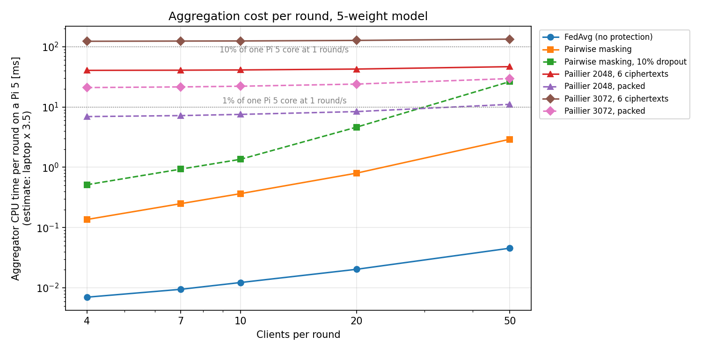

# Secure aggregation: CPU cost per FL round (decision support)

How much would secure aggregation cost per round, compared with the plain
FedAvg the aggregator runs now? Compared: **plain FedAvg**, **pairwise masking**
(SecAgg, Bonawitz et al. 2017, fresh keys every round, with and without
dropouts) and **Paillier** homomorphic encryption (2048 and 3072-bit keys).
Each case is for 4, 7, 10, 20 and 50 clients and our model: 5 weights plus
`num_samples` per update.

Measured on the laptop only (`scripts/secagg_benchmark.py`). The Pi 5 and
ESP32 numbers are **estimates**, not measurements. Nothing was run on the Pi or
the boards, and nothing is integrated into the firmware or the aggregator.
This is input for a decision, not the decision.

## Aggregator cost per round

CPU time for one round: everything the aggregator computes, but not relaying
messages. Laptop: measured, the median of 7 runs. Pi 5: laptop × 3.5 (see
Method), with a pessimistic × 5 in brackets.

| Method | 4 | 7 | 10 | 20 | 50 clients | Pi 5, 7 clients | Pi 5, 50 clients |
|---|---|---|---|---|---|---|---|
| FedAvg (no protection) | 0.002 ms | 0.003 | 0.003 | 0.006 | 0.013 | 0.01 ms | 0.05 ms |
| Masking, no dropout | 0.04 | 0.07 | 0.10 | 0.23 | 0.84 | 0.25 (0.36) ms | 2.9 (4.2) ms |
| Masking, 10% dropout | 0.15 | 0.27 | 0.39 | 1.3 | 7.6 | 0.9 (1.3) ms | 26 (38) ms |
| Paillier 2048, 6 ciphertexts | 11.6 | 11.7 | 11.8 | 12.2 | 13.4 | 41 (58) ms | 47 (67) ms |
| Paillier 2048, packed | 2.0 | 2.1 | 2.2 | 2.4 | 3.2 | 7 (10) ms | 11 (16) ms |
| Paillier 3072, 6 ciphertexts | 35.2 | 35.5 | 35.7 | 36.4 | 38.3 | 124 (178) ms | 134 (191) ms |
| Paillier 3072, packed | 6.0 | 6.2 | 6.3 | 6.9 | 8.5 | 22 (31) ms | 30 (42) ms |

*Packed*: all 6 values of an update in one ciphertext (64 bits each), so the
aggregator decrypts once instead of 6 times. Paillier keys are made once per
run: 26 ms (2048) and 74 ms (3072) on the laptop (a prime search, so it varies
from run to run).



At one round per second, 10 ms of CPU per round is 1% of one Pi 5 core. Our
runs do at most about one round per second (0.1 to 3 s per round plus a 1 s pause).

## Would it put meaningful load on a Pi 5?

- **FedAvg:** no. Under 0.1 ms per round.
- **Pairwise masking:** no. With our 7 clients it costs about 1 ms per round
  even with a dropout. With 50 clients it costs about 3 ms per round without
  dropouts, and 26 to 38 ms with 10% dropouts, which is under 4% of one core at
  one round per second. The dropout case grows fastest: the aggregator
  recomputes the dropped clients' masks, one key agreement per dropped client
  and survivor.
- **Paillier:** small, and almost the same for every number of clients, because
  decryption dominates. 2048-bit costs about 40 to 70 ms per round (7 to 16 ms
  packed). 3072-bit costs about 0.12 to 0.19 s per round (22 to 42 ms packed),
  the only case clearly visible on a CPU graph, but still under 20% of one core
  at one round per second. The aggregator container's 1.0 CPU limit is not at risk.

None of the three would put a meaningful load on a Pi 5 with a 5-weight model.
The real costs are on the ESP32s and in the messages (below). The cost of
masking and Paillier grows with the number of values per update, so a larger
model would change this picture.

## Cost on one ESP32 per round (estimates)

| Method | Laptop, measured | ESP32, 7 clients | ESP32, 50 clients | Upload per round |
|---|---|---|---|---|
| FedAvg | 0 | 0 | 0 | about 0.15 KB |
| Masking, fresh keys every round | 0.39 ms (7), 3.1 ms (50) | 0.1 to 1.4 s | 0.6 to 10 s | 1.5 KB (7), 11 KB (50) |
| Masking, pairwise keys once per run | – | under 0.1 s | under 0.1 s | 0.05 KB, plus shares when dropouts must be handled |
| Paillier 2048, 6 ciphertexts | 40 ms | 0.6 to 1.5 s | same | 3 KB |
| Paillier 2048, packed | 6.7 ms | 0.1 to 0.25 s | same | 0.5 KB |
| Paillier 3072, 6 ciphertexts | 127 ms | 0.5 to 1.5 min | same | 4.6 KB |
| Paillier 3072, packed | 21 ms | 5 to 15 s | same | 0.75 KB |

For scale: local training takes 3.5 to 4.5 ms per round on the ESP32 today.
How the estimates were made:
- **Masking:** a client needs 2 + 2(n−1) X25519 operations per round when keys
  are fresh every round: 14 operations for 7 clients, 100 for 50. One operation
  takes about 5 ms with an optimized implementation (about 7 ms was reported on
  the slower ESP32-S2) and about 100 ms with ESP-IDF's stock mbedTLS. AES and
  SHA-256 have hardware help on the ESP32 and add little. The Shamir shares
  cost 2·n·t multiplications in a 256-bit field: at an assumed 20 to 50 µs
  each in software, about 0.05 to 0.13 s at 50 clients.
- **Paillier 2048:** an encryption is a 4096-bit modular exponentiation with a
  2048-bit exponent: about 2,500 to 3,100 modular multiplications. The ESP32's
  RSA accelerator does a 2048-bit modular multiplication in about 19 µs at
  240 MHz; at 4096 bits that is about 40 to 80 µs.
- **Paillier 3072:** its 6144-bit numbers are larger than the accelerator's
  limit (4096 bits on the original ESP32), so everything runs in software:
  about 2 to 3 ms per modular multiplication, times about 3,600.

The ranges are wide (up to 20x). Before choosing, it is worth timing one
X25519 operation and one Paillier-2048 encryption on one ESP32; that would
need flashing a test board.

## Points for the decision

- **What each method protects.**
  - *Masking:* the aggregator learns only the sum, as long as fewer than t
    clients (here a majority) collude with it. It survives dropouts. But each
    round takes 4 message rounds instead of 1, and every client exchanges
    messages with every other client (through the broker).
  - *Paillier:* whoever holds the private key can decrypt every single
    update. If the Pi aggregator holds the key, it protects nothing against
    the Pi. It needs a separate key holder that only ever decrypts the sum
    (for example the laptop), or threshold Paillier (much more complex).
  - *Neither* stops a client from sending a bad update.
- **Messages:** every secure variant needs a bigger MQTT buffer on the boards
  than the current 512 bytes (`mqtt.setBufferSize`), and ciphertexts in JSON
  need hex or base64 (1.3 to 2× the bytes).
- **Lower client cost:** pairwise keys agreed once per run (as in later SecAgg
  versions) cut the per-round cost of masking on the ESP32 to almost nothing.
  Packing cuts Paillier's cost about 6×.

## Method and caveats

- **Laptop:** Intel Core i7-13620H, pinned to one performance core
  (`taskset -c 0`, up to 4.7 GHz). Python 3.10.12, single thread. Times are CPU
  time (`time.process_time`): the median of 7 repetitions for the aggregator,
  of 5 for the Paillier encryptions, and of 200 calls for each client-side
  operation of masking.
- **Correctness:** every run checks that each method's result equals plain
  FedAvg (fixed point with 2^-24 resolution).
- **Masking, aggregator:** it rebuilds every secret from the shares of the same
  t survivors, so the Lagrange coefficients are computed once per round. Shamir
  sharing uses a 521-bit prime field here; a 256-bit field would be a little cheaper.
- **Masking client cost:** computed as the number of operations times the
  timed cost of each operation, so the same counts give the ESP32 estimate.
- **Pi 5 factor 3.5:** the ratio of single-core Geekbench 6 scores, about
  2,500 to 2,660 for the i7-13620H and 764 to 774 for a Pi 5 at 2.4 GHz.
  Big-integer code can differ from Geekbench's mix (GMP has very fast x86
  assembly), hence the pessimistic × 5. Nothing was measured on the Pi.
- **Not modeled:** network time and the extra message rounds of masking, MQTT
  overhead, and Paillier's key generation on a slower CPU.

## Installed (only for this benchmark)

A venv inside this worktree, `.venv/` (git-ignored), made with the laptop's
Python 3.10.12. The top-level packages are pinned in
`scripts/requirements-secagg.txt`:

| Package | Version | Why |
|---|---|---|
| phe (python-paillier) | 1.5.0 | Paillier |
| gmpy2 | 2.3.2 (GMP 6.3.0) | fast big numbers for phe; what a Pi would use too |
| cryptography | 50.0.2 (its own OpenSSL 4.0.3) | X25519, AES-GCM, AES-CTR for masking |
| matplotlib | 3.10.9 | the chart |

These came in as dependencies: cffi 2.1.1, pycparser 3.11 and typing_extensions
4.16.0 (for cryptography), and numpy 2.2.6, contourpy 1.3.2, cycler 0.12.1,
fonttools 4.65.0, kiwisolver 1.5.1, packaging 26.3, pillow 12.3.0, pyparsing
3.3.3, python-dateutil 3.0.0, six 1.17.0 and tzdata 2026.5 (for matplotlib).
pip was upgraded inside the venv to 26.2.2; setuptools 59.6.0 came with it.
The laptop's ROS 2 `PYTHONPATH` is kept out by running in isolated mode (`python -I`).

## Reproduce

```bash
python3 -m venv .venv
.venv/bin/pip install -r scripts/requirements-secagg.txt
taskset -c 0 .venv/bin/python -I scripts/secagg_benchmark.py    # about 25 s, writes timings.csv
.venv/bin/python -I scripts/plot_secagg_benchmark.py            # writes server_cost.png
```

`timings.csv` has every number in this report: method, side, key size,
clients and CPU milliseconds. The `unit:` rows are the client-side operations
of masking.

## Sources for the estimates

- ESP32 modular multiplication (2048 bits, about 19 µs at 240 MHz); Curve25519
  about 7 ms on the ESP32-S2 and about 100 ms with ESP-IDF's mbedTLS:
  esp32.com forum, https://esp32.com/viewtopic.php?p=85284 and
  https://esp32.com/viewtopic.php?p=85295
- ESP32 RSA accelerator operand sizes 512 to 4096 bits: wolfSSL's ESP32 driver
  (https://gogs.librecmc.org/OWEALs/wolfssl/commit/e22ae7a1f82949fc7099cd1f801704517f6b43ce)
  and Oryx Embedded's driver (https://oryx-embedded.com/doc/esp32__crypto__pkc_8c_source.html)
- Pi 5 Geekbench 6 single-core 764 to 774:
  https://www.raspberrypi.com/news/benchmarking-raspberry-pi-5/
- i7-13620H Geekbench 6 single-core about 2,500 to 2,660:
  https://www.cpu-monkey.com/it/benchmark-intel_core_i7_13620h-geekbench_6_single_core,
  https://laptopmedia.com/?p=1203925,
  https://nanoreview.net/en/cpu-compare/intel-core-i7-13620h-vs-amd-ryzen-7-6800h
- Pairwise masking: K. Bonawitz et al., "Practical Secure Aggregation for
  Privacy-Preserving Machine Learning", ACM CCS 2017.
